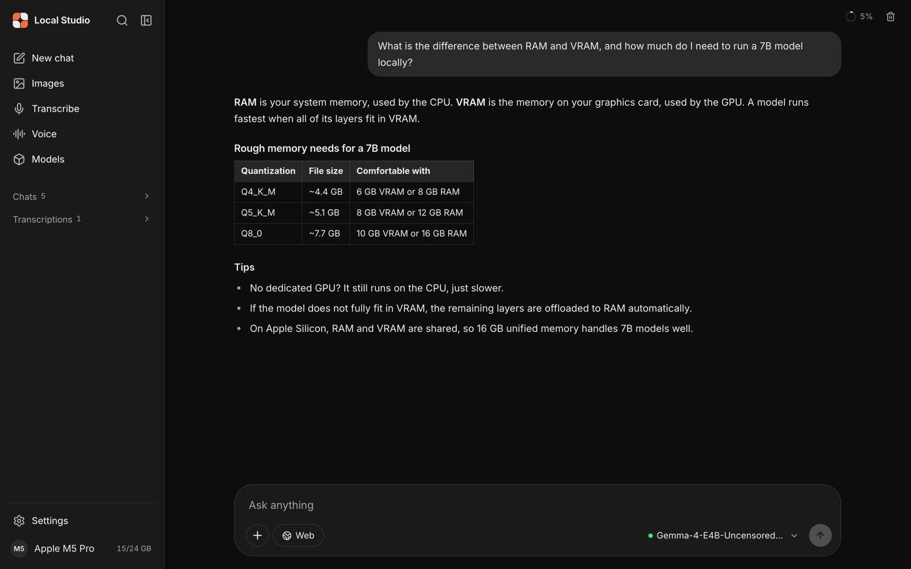

# USAP

**USAP is a local-first AI studio for chat, image generation, speech-to-text and text-to-speech
on your own hardware.** It is an actively developed continuation of the open-source
[Portable Local Studio](https://github.com/techjarves/Portable-Local-Studio) (Portable AI Studio)
by techjarves. USAP keeps that application and its interface as they are, and works on what's underneath:
security, testing, platform coverage, reliability and performance.

  
   
  The original Portable Local Studio interface, preserved unchanged in USAP.

**Status:** pre-release, under active development. There are no USAP release packages yet; you
run it from a checkout, as below. See [Development Progress](#development-progress) and
[Known Limitations](#known-limitations).

## Contents
1. [Project Overview](#usap--project-overview)
2. [Project Origins & Credits](#project-origins--credits)
3. [Current Capabilities](#current-capabilities)
4. [USAP Enhancements](#usap-enhancements)
5. [Platform Compatibility](#platform-compatibility)
6. [Installation & Usage](#installation--usage)
7. [GitHub Actions and Testing](#github-actions-and-testing)
8. [Development Progress](#development-progress)
9. [Development Roadmap](#development-roadmap)
10. [Known Limitations](#known-limitations)
11. [Contributing](#contributing)
12. [License & Acknowledgments](#license--acknowledgments)

## USAP — Project Overview

Everything runs on your machine through a small local web server (`scripts/server/serve.cjs`)
and native engines: [llama.cpp](https://github.com/ggml-org/llama.cpp) for chat,
[stable-diffusion.cpp](https://github.com/leejet/stable-diffusion.cpp) for images,
[whisper.cpp](https://github.com/ggml-org/whisper.cpp) for transcription and
[Kokoro](https://huggingface.co/hexgrad/Kokoro-82M) for speech. Your models, conversations and
outputs stay on your disk. The network is used only to download engines at first setup, to download
models you choose, and for web search if you enable it.

Project goals:
* Preserve the original application, its interface and its features.
* Strengthen backend architecture and maintainability.
* Improve security and reliability.
* Improve native inference performance.
* Support Windows x64, Linux x64, macOS Apple Silicon (arm64) and macOS Intel (x86_64).
* Keep portable/USB operation, and add conventional desktop installers later (planned).
* Prepare optional cloud inference and model routing (planned, off by default).
* Build, test and validate everything in GitHub Actions.

Status words used in this README: **Implemented** (in the code), **Verified** (passed a real
test in CI, with linked evidence), **Experimental**, **Planned** (not built yet) and **Unsupported**.

## Project Origins & Credits

> USAP is based on and developed from the open-source Portable Local Studio (Portable AI Studio)
> project by techjarves.
>
> Original repository: https://github.com/techjarves/Portable-Local-Studio
>
> USAP preserves and builds upon the original project's codebase, functionality, and
> contributions while introducing additional engineering improvements, testing, platform
> compatibility, and future capabilities.
>
> Credit for the original work belongs to its original author and contributors.

* **What upstream built:** the application itself. That includes the interface, the chat, image,
  transcription, voice and model-management workspaces, the launchers and setup scripts, hardware
  backend selection, and web search.
* **What USAP adds:** the items listed under [USAP Enhancements](#usap-enhancements).
* **History:** USAP imported upstream commit `a55c42c` with its full Git history, all 188 commits
  with their original authors and dates, via a merge rather than a copy
  ([import provenance](docs/audit/IMPORT_PROVENANCE.md)).
* **Contributors:** upstream contributors include techjarves (Tech Jarves) and community
  contributors. `git log a55c42c` lists every one of them.
* **License:** the original [MIT license](LICENSE) and its copyright notice
  (Copyright (c) 2026 Tech Jarves) are kept unchanged.

## Current Capabilities

All of the features below were built by the original project. "Verified" marks what USAP's CI has
exercised with real models (see [evidence](docs/ci/MACOS_COMPATIBILITY.md#evidence-by-architecture)).

| Capability | Status | Notes |
|---|---|---|
| Local LLM chat (llama.cpp, GGUF) | Implemented; **CPU verified** on all 4 platforms | Streaming chat, reasoning display, conversation history |
| Image generation (stable-diffusion.cpp) | Implemented; **CPU verified** on all 4 platforms | SD 1.5/SDXL single-file checkpoints, gallery with saved parameters |
| Speech-to-text (whisper.cpp) | Implemented; **CPU verified** on all 4 platforms | |
| Text-to-speech (Kokoro 82M) | Implemented; **verified** on all 4 platforms | |
| Model management | Implemented | Download from the built-in catalogue or Hugging Face, or import local files |
| Hardware acceleration (CUDA, ROCm, Vulkan, Metal, Core ML, OpenVINO NPU) | Implemented upstream; **unverified in USAP** | No GPU has passed a USAP hardware test yet; see [Known Limitations](#known-limitations) |
| Web search for chat | Implemented | DuckDuckGo provider; uses the network when enabled |
| Live hardware monitor and local API | Implemented | CPU/RAM/GPU telemetry; the local `/api/*` HTTP API used by the interface; the image engine's `/sdapi/v1/*` and `/v1/*` routes are proxied on the same port |

More screenshots: [images](docs/screenshots/images.jpg) ·
[transcribe](docs/screenshots/transcribe.jpg) · [voice](docs/screenshots/voice.jpg) ·
[models](docs/screenshots/models.jpg). Supported model formats are listed in the
[original guide](docs/USAGE_UPSTREAM.md#supported-models); the feature-by-feature contract is in
[FEATURE_MATRIX.md](docs/audit/FEATURE_MATRIX.md).

## USAP Enhancements

Changes USAP has made on top of the original project (details in [CHANGELOG.md](CHANGELOG.md)):

* **Provenance-preserving import** of the upstream repository with full history ([#1](https://github.com/dlroqa/usap/pull/1)).
* **Security hardening** ([#2](https://github.com/dlroqa/usap/pull/2)): the local server only serves
  its own files and refuses requests from other websites, with regression tests.
* **Outbound request protection** (Step 9.3): web search, page fetching, model downloads and Hugging Face
  lookups can only reach public internet addresses. Every redirect is checked, and the address that was
  checked is the one connected to. Covered by regression tests against local test services.
* **Download integrity** (Step 9.4): engines, the portable Node.js and catalog models are checked against
  SHA-256 digests pinned in this repository before they are used (Node.js digests come from its signed
  checksum list). Downloads stream to a temporary file and only replace an existing file once every check
  passes, so a failed, interrupted or tampered download keeps the previous version. Community models are
  marked **unverified** (or source-checksum only); the publisher is not authenticated. Model archives
  (Core ML `.zip`) are checked entry by entry and unpacked into a staging folder before they are installed.
  [What is covered](docs/security/DOWNLOAD_INTEGRITY.md).
* **Sign-in for network sharing** (Step 9.5, [#25](https://github.com/dlroqa/usap/pull/25)): when the studio is shared on your network,
  every other device must sign in with a generated access token. This computer is unaffected, and so is
  the default local-only mode. JSON API routes require a JSON content type.
  Status and diagnostics responses report studio-relative or `~/…` paths, so a signed-in device doesn't
  learn the host's user name or folder layout from them ([#52](https://github.com/dlroqa/usap/issues/52)).
  Model lists still show the full location of models you linked in place
  ([#57](https://github.com/dlroqa/usap/issues/57)).
  [How it works](docs/security/LAN_ACCESS.md).
* **Engine supervision** (Step 9.6, [#29](https://github.com/dlroqa/usap/pull/29)): the chat, image, speech and voice engines stop with
  the studio even if it crashes or is killed, so on Linux and macOS they no longer keep running in the
  background. A
  text engine that crashes is restarted automatically (up to 3 times in 10 minutes), but not when it
  ran out of memory. Stopping during
  a model load cancels it at once. [Details](docs/runtime/ENGINE_SUPERVISION.md).
* **Consistent API errors** (Step 9.7, [#35](https://github.com/dlroqa/usap/pull/35)): every error keeps its `error` message and gains a
  machine-readable `code`. Invalid requests answer 400 instead of 500, and a missing engine answers 503.
  A malformed request can no longer stop the server. Messages never include stack traces or the host's
  folder paths. [Reference](docs/runtime/API_ERRORS.md).
* **Model formats and quantization** (Step 9.8f): which formats and quantized variants each engine reads, and
  which were verified in CI, are documented in [Model formats](docs/runtime/QUANTIZED_MODELS.md). A read-only
  `GET /api/model-inspect` reports a model's format, quantization, architecture, engine and a rough memory
  estimate from its header (**Implemented**; the interface doesn't use it yet). Not every quantized model
  runs: only what the shipped engine versions read.
* **GitHub Actions CI** on Windows x64, Linux x64, macOS arm64 and macOS Intel, with native-hardware
  checks so Intel results aren't Apple Silicon emulating Intel ([#3](https://github.com/dlroqa/usap/pull/3)).
* **UI regression protection** ([#4](https://github.com/dlroqa/usap/pull/4)): pixel-exact
  screenshot baselines of the original interface, plus behaviour and accessibility tests, run on 4 targets for every change.
* **Chat reliability:** a finished or failed reply no longer gets overwritten by a late streaming
  update ([#6](https://github.com/dlroqa/usap/pull/6)).
* **Accessibility:** the image-size control's accessible name now matches its visible label ([#7](https://github.com/dlroqa/usap/pull/7)).
* **Mobile layout:** at phone width, the sidebar becomes a drawer instead of squeezing the content ([#8](https://github.com/dlroqa/usap/pull/8)).
* **Intel macOS:** first-time setup works on Intel Macs ([#5](https://github.com/dlroqa/usap/pull/5)), and image generation is installed and works there on the CPU ([#9](https://github.com/dlroqa/usap/pull/9)).
* **Verified native CPU inference** on all 4 platforms through the real launchers ([#9](https://github.com/dlroqa/usap/pull/9)).
* **Image generation speed:** the engine no longer uses more threads than the machine has CPUs. That was a ~4–5× slowdown on 4-core Macs ([#9](https://github.com/dlroqa/usap/pull/9)).

## Platform Compatibility

CPU results come from the [`native-runtime`](.github/workflows/native-runtime.yml) workflow:
fresh setup through the real launcher, real inference through the app, then a second launch.
Latest evidence: [run 42733046302](https://github.com/dlroqa/usap/actions/runs/42733046302).

| Platform | Setup + relaunch | Chat | Speech-to-text | Text-to-speech | Images | GPU acceleration |
|---|---|---|---|---|---|---|
| Windows x64 | Verified | Verified (CPU) | Verified (CPU) | Verified | Verified (CPU) | CUDA / Vulkan: implemented, **unverified** |
| Linux x64 | Verified | Verified (CPU) | Verified (CPU) | Verified | Verified (CPU) | CUDA / ROCm / Vulkan / OpenVINO NPU: implemented, **unverified** |
| macOS Apple Silicon | Verified | Verified (CPU) | Verified (CPU) | Verified | Verified (CPU) | Metal / Core ML: implemented, **unverified** |
| macOS Intel | Verified | Verified (CPU) | Verified (CPU) | Verified | Verified (CPU, slow, see limitations) | Metal: **unverified** |

Hosted CI runners have no usable GPU, so a green run proves CPU inference only.
[RUNNER_REQUIREMENTS.md](docs/ci/RUNNER_REQUIREMENTS.md) describes how GPU backends get verified.

## Installation & Usage

Today USAP runs as the **portable/USB edition**: one folder you can keep on an internal or
external drive, with no system-wide installation. Desktop installers are **planned**, not
available (see the [roadmap](#development-roadmap)).

1. Get the code: `git clone https://github.com/dlroqa/usap.git` (or download the ZIP).
2. Launch:
   * **Windows:** double-click `windows.bat`.
   * **Linux:** `chmod +x linux.sh && ./linux.sh`.
   * **macOS:** `chmod +x mac.sh && ./mac.sh`.
3. **First launch** runs setup automatically. It downloads a portable Node.js, the engines for
   your platform and the frontend dependencies into the folder, a few GB depending on platform.
   Later launches skip it.
4. Open `http://localhost:1420`.
5. **Models aren't included.** Download them in the **Models** tab or put files in `app/models/`
   (images), `app/llm-models/` (chat) or `app/speech-models/` (transcription). Each model has its
   own license.

Platform notes:
* **Linux:** the prebuilt engines need glibc 2.38+ (for example Ubuntu 24.04). `./linux.sh --max-perf` adds ROCm, and `--setup-openvino` adds Intel NPU support.
* **Windows:** 64-bit Windows 10 or 11.
* **macOS:** whisper.cpp is installed through Homebrew. On Intel Macs, images use the CPU by default.
* **Model downloads from your own network** (for example a NAS mirror) are refused by default. Set
  `USAP_ALLOW_LAN_DOWNLOADS=1` to allow private-network hosts. This machine's own addresses and cloud
  metadata addresses are always refused.
* **Downloads are verified** where USAP has a pinned digest. If a download fails verification it is
  discarded and the previous file or engine is kept. Models from Hugging Face search or pasted URLs are
  checked only for transfer integrity, or not at all
  ([details](docs/security/DOWNLOAD_INTEGRITY.md)). Changing an engine version with `LLAMA_RELEASE` or
  `WHISPER_RELEASE` installs it unverified, with a warning.
* **LAN access** is off by default. `UAIS_HOST=0.0.0.0` opens the studio to your network. Other
  devices then have to sign in with the access token in `app/config/lan-access-token` (shown with
  `node scripts/server/lan-auth.cjs show`). The connection is plain HTTP, so share it only on a network
  you trust ([details](docs/security/LAN_ACCESS.md)).

For troubleshooting (ports, GPU drivers, Windows error codes, building engines from source), see
[docs/USAGE_UPSTREAM.md](docs/USAGE_UPSTREAM.md). That's the original project's detailed guide, kept as written.

## GitHub Actions and Testing

| Workflow | What it checks | When |
|---|---|---|
| [`ci`](.github/workflows/ci.yml) | Frontend build, server unit tests, security regression tests, **API contract tests** (61 recorded calls: routes, status codes, response schemas, error format, Origin/Host security, file confinement, model and conversation operations, behaviour without engines, chat streaming format, order and failure handling on all 4 platforms; [details](scripts/tests/api-contract/README.md)), backend smoke test, on Windows x64, Linux x64, macOS arm64 and macOS Intel (native hardware asserted) | every PR and push; **required** |
| [`render-e2e`](.github/workflows/render-e2e.yml) | Real built UI in Playwright: pixel-exact screenshots of the original interface, behaviour tests, accessibility (axe) | every PR and push; **required** |
| [`native-runtime`](.github/workflows/native-runtime.yml) | Real first-time setup, binary architecture checks, real chat/speech/voice/image inference with small pinned models, second launch | PRs touching setup/server/launchers, weekly, on demand |
| [`docs`](.github/workflows/docs.yml) | README links resolve, upstream attribution and license notices present, no planned feature described as available | PRs and pushes touching docs |

`main` is protected: 8 required checks (`build-test` and `render` on 4 targets), pull requests
only, no force pushes. Details: [CI_GUIDE.md](docs/ci/CI_GUIDE.md),
[RENDER_TESTS.md](docs/ci/RENDER_TESTS.md), [BRANCH_PROTECTION.md](docs/ci/BRANCH_PROTECTION.md).

## Development Progress

| Milestone | Status |
|---|---|
| Import with provenance, audit | Done (#1) |
| Security fixes S-1–S-3 | Done (#2) |
| 4-platform CI, UI regression gates | Done (#3, #4) |
| Intel macOS setup; chat, accessibility and mobile fixes | Done (#5–#8) |
| **Step 8:** native inference verification | **CPU done** on all 4 platforms (#9); GPU pending real hardware |
| Desktop installer requirement documented | Done (#10), planning only |
| **Step 9:** foundational backend | **In progress** ([plan](docs/roadmap/STEP9_BACKEND_PLAN.md), #11). 9.1 API contract tests done (#13); 9.2 single data-root resolver done (#15); 9.3 outbound request protection done (#16); Windows streaming tests done (#17); 9.4 download integrity done (#18); 9.5 LAN sign-in done (#25); 9.6 engine supervision done (#29); 9.7 API error consistency done (#35); 9.8 modular backend in development ([plan](docs/roadmap/STEP9_8_MODULES.md); 9.8a request pipeline and system routes done (#36); 9.8b text-to-speech module done (#37); 9.8c speech recognition module done (#40); 9.8d web search module done (#46); 9.8e hardware and diagnostics module done (#56); 9.8f model management and downloads module done (#59, #60); 9.8g image generation module in review) |

## Development Roadmap

* **Step 9, foundational backend** (current): API contract tests; a paths/config module ready for
  portable and installed storage; remaining security findings; engine crash supervision and
  diagnostics; consistent API errors; modular backend (9.8; 9.8g image generation and 9.8h chat and
  streaming remain); 9.9 resource scheduling; 9.10 performance benchmarks; 9.11 an optimized Intel
  image engine; 9.12 installed-mode storage preparation. [Plan](docs/roadmap/STEP9_BACKEND_PLAN.md).
* **Step 10, desktop installers** (planned): an installed edition next to the portable one,
  Windows `.exe`/`.msi`, Linux AppImage/`.deb`, macOS Apple Silicon and Intel `.dmg`, from the same
  code and interface. [Requirements](docs/roadmap/DESKTOP_INSTALLERS.md).
* **Step 11, installation and release testing** (planned): install, first launch, upgrade and
  uninstall tests that preserve user data; signing and notarization.
* **Step 12, production release** (planned): validated architecture-specific releases.
* **Later, as separate modules** (planned, none implemented): multi-user accounts and API keys
  ([#28](https://github.com/dlroqa/usap/issues/28)), Cloudflare-backed user data with offline/online
  sync, a dedicated prompt-injection defence layer, and optional cloud inference and model routing, off by default.

USAP is not production-release-ready until both the portable and the installed editions pass their
validation. Full priorities: [PRIORITIES.md](docs/roadmap/PRIORITIES.md).

## Known Limitations

* **GPU acceleration is unverified in USAP.** No GPU backend (CUDA, ROCm, Vulkan, Metal, Core ML,
  OpenVINO NPU) has passed a real hardware test yet. The code is upstream's and may work on your
  machine, but USAP doesn't claim it.
* **macOS Intel image generation is slow.** The upstream engine's Intel build lacks AVX
  optimizations. A 256×256 test image takes ~6 minutes on a 4-core CI Mac. An optimized Intel
  engine is planned ([details](docs/ci/MACOS_COMPATIBILITY.md#intel-performance-limitation)).
* **Metal image generation fails on virtualized Macs** (the engine stops with an unsupported-operation error). Use the CPU
  option there. It's unverified on physical Macs.
* **No release packages or installers yet.** Run from a checkout.
* **macOS whisper depends on Homebrew.**
* **Linux engines need glibc 2.38+.**
* **Not every download is authenticated.** Community models, the Visual C++ runtime, Kokoro voice
  weights, Python/npm packages and source builds don't have pinned digests
  ([list](docs/security/DOWNLOAD_INTEGRITY.md#what-is-covered)). Pinned digests are not code signatures.
* **Portable setup doesn't enforce the lockfile exactly** (S-10). It uses `npm install`, which checks
  each package against the lockfile's integrity hash but doesn't guarantee an exact reproduction. CI
  uses `npm ci`. A staged update that keeps the per-OS dependency folders and offline re-setup is
  planned ([#22](https://github.com/dlroqa/usap/issues/22)).
* **Only the text engine restarts by itself after a crash.** The image, speech and voice engines
  report the failure; the optional Intel NPU worker isn't supervised yet, and memory awareness is basic
  ([details](docs/runtime/ENGINE_SUPERVISION.md#limitations); [#30](https://github.com/dlroqa/usap/issues/30)–[#33](https://github.com/dlroqa/usap/issues/33)).
* **Web search content is untrusted and USAP is not prompt-injection-safe.** Web results are added as
  untrusted user-role context and can't trigger any operation, but no adversarial defence exists yet.
  Automatically planned search queries use only your own recent messages, and a query that copies
  other conversation text is refused (#43). Results marked as sponsored, and ad-click redirects, are
  never used as sources or opened (#50)
  ([trust boundary](docs/security/WEB_CONTENT_TRUST.md); [#42](https://github.com/dlroqa/usap/issues/42), [#43](https://github.com/dlroqa/usap/issues/43), [#50](https://github.com/dlroqa/usap/issues/50)).
* **LAN sharing uses plain HTTP and one shared token**: no built-in HTTPS, no user accounts. Use it
  only on a trusted network, and never expose the studio directly to the internet
  ([details](docs/security/LAN_ACCESS.md#limitations); follow-ups [#26](https://github.com/dlroqa/usap/issues/26)–[#28](https://github.com/dlroqa/usap/issues/28)).
* **Open security-hardening work**, tracked before production release packaging:
  * Windows setup engine staging and rollback ([#19](https://github.com/dlroqa/usap/issues/19), pre-release)
  * Verifying the Visual C++ runtime, portable Python and `get-pip.py` ([#20](https://github.com/dlroqa/usap/issues/20), pre-release)
  * Kokoro weights ([#21](https://github.com/dlroqa/usap/issues/21))
  * Dependency installs ([#22](https://github.com/dlroqa/usap/issues/22))
  * Source builds and Python packages ([#23](https://github.com/dlroqa/usap/issues/23))
  * Unavailable catalog models ([#24](https://github.com/dlroqa/usap/issues/24))

## Contributing

* Work through pull requests to `main`. All 8 required checks must pass, and merges use merge commits.
* **Preserve the UI.** No redesigns. Visual baselines change only through the guarded process in
  [RENDER_TESTS.md](docs/ci/RENDER_TESTS.md), and never to hide a regression.
* **Keep the README current.** If a PR changes functionality, installation, compatibility, security
  behaviour, testing or project status, update this README (and [CHANGELOG.md](CHANGELOG.md) for
  user-facing changes) in the same PR. Otherwise, write "README update not required" in the PR
  description with a reason. Use the status words Implemented / Verified / Experimental /
  Planned / Unsupported, and link evidence for "Verified".
* Report security issues privately (GitHub private vulnerability reporting), not in public issues.

## License & Acknowledgments

* USAP is distributed under the original project's [MIT License](LICENSE), Copyright (c) 2026 Tech Jarves.
* Thanks to techjarves and all contributors to
  [Portable Local Studio](https://github.com/techjarves/Portable-Local-Studio), whose work this project is built on.
* **Third-party components** (downloaded at setup, each under its own license):
  * llama.cpp, whisper.cpp and stable-diffusion.cpp (MIT)
  * Node.js (MIT)
  * React and Vite (MIT)
  * pdf.js (Apache-2.0)
  * Inter font (OFL-1.1)

  The full inventory is in [DEPENDENCIES.md](docs/audit/DEPENDENCIES.md).
* **Models** are not distributed with USAP. Each model you download is under its creator's license.
