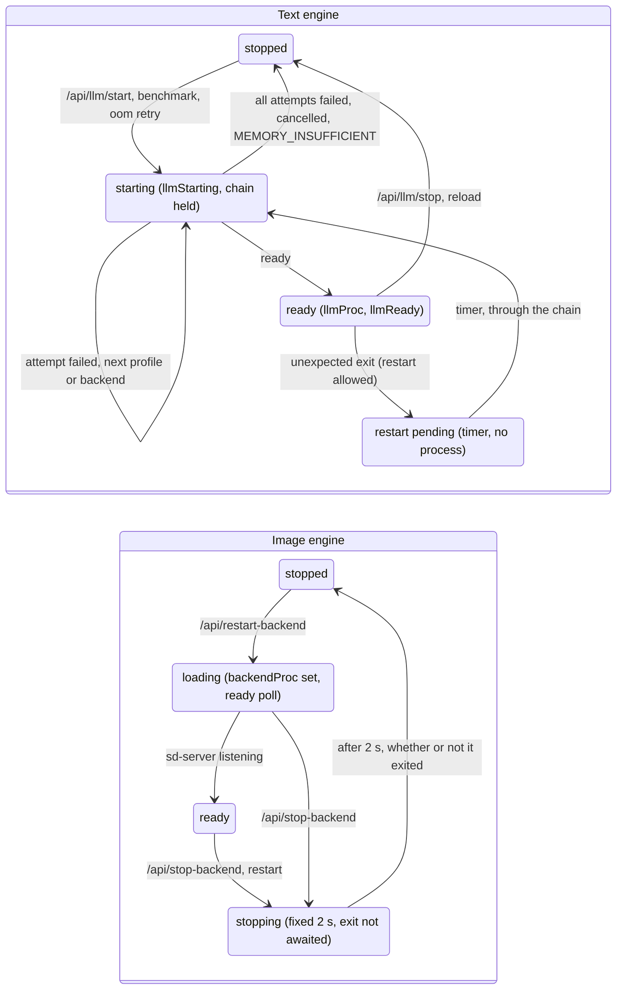

# Issue #105: cross-engine model-load coordination (design)

Status: design merged (#111). **Implemented, off by default** (`engineSlot: "off"`), with the choices in §13
("As built"), which take precedence over §6–§12 where they differ. Turning it on by default needs separate owner
approval and four-platform validation. Turning it off restores compatibility, not the exclusivity guarantee: with
the slot off, the race in §4 is still there.

Scope: how text-model and image-model **load, reload and unload** are coordinated so that two lifecycle operations
can't conflict. It doesn't cover inference scheduling (chat, image generation, Whisper, Kokoro), GPU/VRAM
accounting, or changes to the "one heavy model at a time" policy (decision B).

Code references are to `main` at `cf8e5c8`.

## 1. Summary

* The race in #105 is real and **reproduces deterministically** with the existing fake engines and no fixture
  change (§4). Five scenarios fail on every run: both heavy engines resident, two image engines for one slot (one
  untracked, surviving `POST /api/stop-backend`), a stop request that doesn't stop an image load in progress, a
  refused image request that has already killed the working image engine, and a `500` where the contract is `409`.
* Root cause: the heavy-model rule is a **check, not an ownership record**. It looks at engine processes, which
  exist only after a spawn, and each load path then awaits several stops before spawning. Text loads are
  serialized among themselves; image loads aren't serialized at all, and neither kind is serialized with the other.
* Recommendation (§6): keep the existing text chain, add an **image lifecycle chain**, and add one small
  **synchronous heavy-engine slot** that both kinds reserve before their first await. The slot has an epoch, is
  released only on a **confirmed process exit**, and refuses the other kind at once with the existing
  `409 MODEL_ALREADY_ACTIVE`. Neither path stops the other engine any more. Inference never touches the slot, so
  nothing that runs today is blocked by it.

## 2. Today: load paths and what serializes them

| | Text | Image (sd.cpp, OpenVINO NPU, Apple NPU) |
|---|---|---|
| Entry points | `POST /api/llm/start`, `/api/llm/benchmark`, chat out-of-memory retry (`chat.cjs:97`), supervisor auto-restart (`llm-engine.cjs:484`) | `POST /api/restart-backend` (`routes/image.cjs:55`) |
| Serialized with its own kind | Yes: `runExclusiveLlmOperation` (`llm-engine.cjs:110`), one FIFO chain | **No.** The CPU/GPU path is awaited per request, but two requests interleave. The OpenVINO and Apple NPU paths start in the background (`startBackend(...).catch`, `routes/image.cjs:89,117`) and answer at once |
| Serialized with the other kind | No | No |
| Heavy-model check | `assertNoOtherActiveRuntime("text")` at the start of **each attempt** (`llm-engine.cjs:804`) | In the route (`routes/image.cjs:70`) and again in `startBackend` (`image-engine.cjs:714`) |
| What the check sees | `getActiveHeavyRuntime()` (`serve.cjs:305`): an engine that is ready **or has a process**. A load before its spawn is invisible. Image is tested first | same |
| Awaits between check and spawn | `killBackend()`, `killOpenVinoWorker()`, `killLlm()` (`llm-engine.cjs:812-814`), port search. `killLlm()` with no process still waits up to 1.5 s for the text port | route: `killBackend()` + fixed 500 ms (`routes/image.cjs:86-87`); `startBackend`: `killLlm()`, `killOpenVinoWorker()`, port search |
| Stops the other kind's engine | `killBackend()`, `killOpenVinoWorker()`, outside any image ordering | **`killLlm()` directly, outside the text chain** (`image-engine.cjs:716`) |
| Stop, and exit confirmation | `terminateLlmProc` (`llm-engine.cjs:411`): SIGTERM, wait for exit 2.5 s, SIGKILL, wait 2.5 s, then wait for the port | `killBackend` (`image-engine.cjs:689`): SIGTERM, fixed 2 s, SIGKILL, **resolves without waiting for the exit**. `killOpenVinoWorker` (`:482`): 0.8 s, SIGKILL, no exit wait |
| Cancel a load in progress | `stopLlmNow()` bumps `llmStartToken`; each attempt checks it | **None.** `POST /api/stop-backend` only kills a process that already exists |
| Stale-callback guards | `llmProc !== proc` in every handler; `llmProcSeq` | `backendProc !== proc` in exit/error handlers; `backendProcSeq` is logged only. The NPU background `.catch` writes `backendError` and `backendLoadState` with no guard |
| Other lifecycle callers | `routes/models.cjs:200` (delete model) calls `killLlm()` outside the chain | — |

Shutdown (`serve.cjs:1843-1844`) stops everything directly. That stays as it is.

### 2.1 Current lifecycle, as the code actually behaves



There is no shared state between the two machines except `getActiveHeavyRuntime()`, which reads process fields,
and two direct cross-kills: the text load stops the image engine, and the image load calls `killLlm()`. A text
`restart pending` has no process, so the image check passes and the image path's `killLlm()` cancels the restart
timer from outside the text chain.

## 3. Root cause

1. **Check-then-act with awaits in between.** `assertNoOtherActiveRuntime` decides from process fields, and both
   load paths then await stops and port searches before the spawn sets those fields. Two loads of different kinds
   can both pass their checks.
2. **No ownership record.** "Which kind owns the heavy slot" is inferred from `llmProc`, `backendProc`,
   `openvinoProc` and the ready flags. None of them is set while a load is between its check and its spawn, or
   between its attempts.
3. **No image serialization and no image start token.** Two image loads interleave, share `currentSettings`,
   `PORT_BACKEND` and `backendProc`, and a stop can't cancel a load in progress.
4. **"Stopped" doesn't mean "exited".** `killBackend` and `killOpenVinoWorker` resolve on timers. A slot that is
   given up on a timer can be handed to the other kind while the old process still holds memory, a port or a GPU
   context.
5. **Cross-kills.** Each path stops the other kind's engine directly, outside the other kind's ordering. That is
   the opposite of ownership.
6. **The error contract leaks.** `MODEL_ALREADY_ACTIVE` thrown inside a text attempt is caught by the
   profile/backend loop as an ordinary failure, so the route answers `500 ENGINE_START_FAILED`.

## 4. Deterministic reproduction

Reproduced locally on `cf8e5c8` (Linux x64, Node 22) through the real server, with the existing api-contract
harness and the unchanged fake engines (`fake-llama-server.cjs`, `fake-sd-server.cjs`). The timing is controlled
by fixed delays that are already in the code, not by luck:

* **Holding a text load between its check and its spawn:** the test listens on the server's preferred text port.
  `killLlm()` with no process then waits its fixed 1.5 s for that port (`waitForPortAvailable(PORT_LLM, 1500)`),
  and `findAvailableLlmPort()` then picks another port. The text load is held for a known 1.5 s after it passed
  its check.
* **Holding an image load:** the route's fixed 500 ms pause after `killBackend()`.

| # | Steps | Result on `cf8e5c8` | Runs |
|---|---|---|---|
| R1 | Occupy the text port. `POST /api/llm/start` (plain model); 100 ms later `POST /api/restart-backend` (CPU) | Both `200`. A live `llama-server` **and** a live `sd-server`; `/api/resources` reports text `ready` and image `ready` | 7/7 |
| R5 | R1 in reverse: image first, text 100 ms later | Both `200`, both engines resident | 4/4 |
| R2 | Two `POST /api/restart-backend` at once (same model, `steps` 4 and 5) | Two `sd-server` spawns with **the same port** (8/8). One fails with `EADDRINUSE`. In 7/8 runs the failed one was the tracked `backendProc`, so the studio reports `running: false` while an untracked engine serves the port and **survives `POST /api/stop-backend`** (still alive 10 s later; only the supervisor stops it at server exit) | 8/8 and 7/8 |
| R4 | `POST /api/restart-backend`; 150 ms later `POST /api/stop-backend` | Stop answers `200 {ok:true}`; the load finishes anyway and the image engine is running | 4/4 |
| R1b | From the R1 state, after one generation, `POST /api/restart-backend` with new settings (same model) | The route's check passes (image is tested first), it **kills the working image engine**, then `startBackend`'s check sees text and answers `409`. The user loses the image engine and gets an error | 6/6 |
| R3 | Image model loaded; `POST /api/llm/start` | `500 ENGINE_START_FAILED` "…failed on all available llama.cpp backends. Last failure: … already loaded as a Image model", not `409 MODEL_ALREADY_ACTIVE` | 8/8 |

Not reproduced: an image load terminating a **live** text engine (scenario 2 in #105). `startBackend` has no
await between its check and `killLlm()`, so `killLlm()` only finds a process that would have failed the check,
except when the image engine is tested first (R1b), where the second check refused first. What the image path's
`killLlm()` does reach today is the no-process case: it clears `llmReady`, resets the vision fields and **cancels
a pending text auto-restart** from outside the text chain. That is reasoned from the code, not reproduced.

Memory admission (9.9f-2) stays safe in these runs, as designed: during an overlap it records low confidence and
never refuses. But in R1 and R5 it can't see an image load that is still in the route's 500 ms pause (no image
process, `backendLoadState` not yet active), so its C5 activity check passes for a decision that is about to be
wrong. With admission off (the default) nothing changes.

The reproduction script and its output are kept as local evidence, outside the repository. They become the
regression tests in §9.

## 5. Alternatives

| Option | Prevents R1/R5 | R2/R4 | Blocks independent inference | Cost and risk |
|---|---|---|---|---|
| **A. One global engine-operation mutex** (text and image lifecycle in one chain) | Yes | Yes | No, if only lifecycle enters it. But an image load waits behind a text load of up to 6 min (CPU ready timeout) only to be refused | Simple. The waiting is pointless under decision B, and a later "both loaded" policy would need it undone. The text chain's restart and oom-retry paths would wait behind image NPU compiles (up to 6 min) |
| **B. Shared lifecycle coordinator** (one module owns every start, stop and restart of both engines) | Yes | Yes | No | The most complete, but it moves the start logic of both engines (1,300 lines each). Too broad for a correctness fix; risk to the 4-platform behaviour |
| **C. Serialized model transitions** (a transition queue across kinds) | Yes | Yes | No | Same waiting problem as A. Adds a queue before 9.9f-3 has decided its queue policy |
| **D. Per-engine locks plus explicit cross-engine ownership** (text chain as today, a new image chain, one synchronous slot) | Yes | Yes (image chain + start token) | **No**: the slot is taken only by loads, and the other kind is refused at once instead of waiting | Small. Two independent chains with one fixed lock order (§6.6). Keeps each engine's start code |
| **E. Epochs only** (generation numbers on callbacks) | No | No | No | Necessary for stale callbacks, not sufficient: it detects a conflict after the fact |

**Recommendation: D, with E inside it.** It is the narrowest change that turns the heavy-model rule into an
ownership record. A global lock (A) is not justified: under decision B the right answer to a load of the other
kind is an immediate `409`, not a wait. B and C are broader than this issue needs.

## 6. Proposed ownership and synchronization policy

### 6.1 The heavy-engine slot

A small module (proposed: `scripts/server/services/engine-slot.cjs`) owns one record:

```
{ owner: null | "text" | "image", model, phase: "idle" | "loading" | "loaded" | "restart-pending" | "unloading",
  epoch, since, pending: [process records whose exit hasn't been seen] }
```

* `reserve(kind, model)` is **synchronous** and is called **before the first await** of a load, inside that
  kind's own chain:
  * slot idle → owner = kind, phase `loading`, `epoch += 1`, returns the epoch;
  * same kind (reload, new settings, profile fallback, benchmark, oom retry, auto-restart) → keeps ownership,
    `epoch += 1`. Same-kind ordering is the job of that kind's chain, as today;
  * other kind, any phase but `idle` → throws `409 MODEL_ALREADY_ACTIVE` at once (§6.4).
* `markLoaded(epoch)`, `markRestartPending(epoch)` and `release(epoch)` do nothing if `epoch` isn't current, so a
  late callback from an older attempt can't change the slot.
* `release` happens only when every process the owner spawned has a **confirmed exit** (§7). Until then the phase
  is `unloading`, and the other kind is still refused.
* `getActiveHeavyRuntime()` reads the slot first and the process fields second. While the two disagree (a process
  alive with the slot idle, or the reverse), that is an invariant violation: it is logged, reported in
  `/api/resources` (an additive field), and treated as busy.

The slot is held across the **whole** `startLlm` (every backend and profile) and the whole image start, so the
gaps between attempts are covered.

### 6.2 Text path

* `startLlm` reserves the slot once, before `startLlmAttempts`. On success: `loaded`. On failure, cancel or
  `MEMORY_INSUFFICIENT`: release after the confirmed exit.
* `startLlmWithBackend` keeps `assertNoOtherActiveRuntime` as a defensive check, but **stops calling
  `killBackend()` and `killOpenVinoWorker()`**. With the slot owned by text there is no image process to stop. If
  one exists anyway, that is the invariant violation above, and the attempt ends as `409`, not as a cross-kill.
* An unexpected exit with an allowed restart moves the slot to `restart-pending`, owned by text. The restart
  timer's start goes through the chain as today. If no restart is allowed, release.
* `POST /api/llm/delete-model` stops the engine through `runExclusiveLlmOperation`, not directly.
* `/api/llm/stop` keeps `stopLlmNow()` (cancel at once, outside the chain, by design) followed by the chain stop.

### 6.3 Image path

* New `runExclusiveImageOperation`, the same FIFO pattern as the text chain. `POST /api/restart-backend` (all
  backends), `POST /api/stop-backend` and the NPU background starts run in it. The NPU routes still answer at once
  (the background start is enqueued, not awaited), so their UX is unchanged.
* The route reserves the slot **before** `killBackend()`. That fixes R1b: a request that will be refused no
  longer stops the working engine first.
* `startBackend` **no longer calls `killLlm()`**. If text owns the slot, the request is refused. One case is
  handled on purpose: if text is only `restart-pending` (no process), the image request asks the text chain to
  cancel the restart and release (`runExclusiveLlmOperation(() => killLlm())`), then reserves. That keeps today's
  user-visible behaviour (an image load after a text crash works) without touching text state from outside its
  chain.
* An image start token, like `llmStartToken`: `/api/stop-backend` bumps it. A start that sees a new token ends as
  `ENGINE_START_CANCELLED` before its spawn, or stops its own process if it already spawned. That fixes R4.
* The existing `409` while a generation is active stays.

### 6.4 Error contract

* A load refused because the other kind owns the slot answers **`409 MODEL_ALREADY_ACTIVE`**, the code the routes
  and the WebUI already know, with the existing `activeRuntime: { type, label, model }` plus an additive `phase`.
* The message keeps today's wording, `"<model>" is already loaded as a Text model. …` (or `Image`). The original
  WebUI's Generator matches `/already loaded as a text model/i` (`Generator.jsx:710`). While the other kind is
  loading or unloading, the wording gains a suffix but keeps that prefix. No UI change.
* `MODEL_ALREADY_ACTIVE` inside a text attempt ends the start at once (like `MEMORY_INSUFFICIENT` does today):
  no other profile or backend is tried, and the route answers `409`. That fixes R3.

### 6.5 Engine generations (epochs)

* Every spawn records the slot epoch it was made under (`proc.usapEpoch`), next to the existing `llmProcSeq` and
  `backendProcSeq`.
* The existing guards (`llmProc !== proc`, `backendProc !== proc`) stay. Epochs cover what they don't:
  slot release, the image ready poll, and the NPU background `.catch`, which today writes `backendError` and
  `backendLoadState` with no guard.
* The 9.9f-1 chat-timeout gate keeps using `llmProcSeq` ("a new engine process means the uncertain work is gone").
  The epoch doesn't replace it.

### 6.6 Lock order and deadlock

* The text chain never waits for the image chain.
* The image chain may wait for the text chain in one place only: cancelling a `restart-pending` text slot (§6.3).
  That text operation never waits for the image chain.
* The slot itself is synchronous and never awaited. So there is one wait edge, image → text, and no cycle.
* Shutdown keeps bypassing both chains.

### 6.7 What doesn't change

* Chat, streaming, the chat queue, image generation, Whisper and Kokoro don't take the slot or a chain.
* Text loads keep their FIFO order and their timings. Decision B stays exactly as it is, and nothing is queued
  across kinds.
* API endpoints, response shapes (additive fields only), saved settings and the WebUI.

## 7. Process-exit confirmation

* "Released" means the engine process's `exit` event has fired. For a supervised engine, that is the guard's
  `exit`, which follows the engine's own exit, so the supervisor snapshot agrees.
* Port closure, a closed HTTP connection and a timer are **not** proof. The port wait in `terminateLlmProc` stays,
  but only as a second check after the exit.
* `killBackend` and `killOpenVinoWorker` get the same shape as `terminateLlmProc`: SIGTERM, wait for exit
  (2.5 s), SIGKILL, wait for exit (2.5 s), then the port check. The fixed 2 s and 0.8 s waits go.
* If no exit is seen after SIGKILL (a hung driver or a zombie): the slot stays `unloading`, with a `stuck` reason
  in `/api/resources` and the log. The other kind keeps getting `409`. The late `exit` event releases it.
  Whether a stuck slot may be overridden after a bound is open decision 5.
* Windows: SIGKILL maps to `TerminateProcess`, and the `exit` event follows the actual process exit. The OpenVINO
  worker isn't supervised, so its `exit` event is the only signal. Both are validated natively (§10).

## 8. Cancellation, reload, restart and recovery

| Situation | Proposed behaviour |
|---|---|
| A load waiting in its own chain | Holds no slot. It reserves when its turn comes (and may then get `409`) |
| Client disconnects during a load | Unchanged: the load continues (open decision 8) |
| `/api/llm/stop` during a text load | As today: `stopLlmNow()` bumps the token, the attempt ends `ENGINE_START_CANCELLED`, the slot is released after the exit |
| `/api/stop-backend` during an image load | New: the image token is bumped, and the load ends before or right after its spawn. The slot is released after the exit (R4) |
| Text reload or settings change | Same kind: ownership is kept and the epoch increments. The old process's exit is confirmed before the new spawn, as `terminateLlmProc` already does |
| Image settings change, same model | Same kind, in the image chain. The old process's exit is confirmed (new), then the new spawn |
| Switching kinds | Unload first, as the WebUI already does. The load of the other kind is refused until the exit is confirmed |
| Text crash, restart allowed | `restart-pending`, owned by text. The restart goes through the chain. An image load in that window cancels it through the text chain (§6.3) |
| Text crash, no restart (out of memory, low memory, limit reached) | The slot is released after the exit |
| Chat out-of-memory retry | Same kind, in the text chain, as today. Admission path `oom-retry` unchanged |
| Profile or backend fallback | Same reservation for the whole start, so there is no gap between attempts |
| Benchmark | Same kind, in the text chain. It holds the slot for the whole benchmark and its model restore |
| Image engine crash | The exit handler releases the slot (epoch-checked). No image auto-restart exists, and none is added |

## 9. Compatibility

### 9.1 With 9.9f-1 chat timeouts and cancellation

* The timeout gate, `UNRESPONSIVE` and its recovery don't load or stop engines, so they don't touch the slot.
* A text reload while `UNRESPONSIVE` is allowed (same kind), and the new `llmProcSeq` ends the state
  ("engine-replaced"), as today.
* An image load while text is `UNRESPONSIVE`: text owns the slot, so `409`, as today when a text model is loaded.
* Gain: an image load can no longer kill the text engine under a running chat stream or a pending cancellation
  confirmation.
* Chat queue slots and their ownership rules are untouched.

### 9.2 With 9.9f-2 memory admission

* The decision point (after the stops, right before the spawn) stays, now inside a slot owned by text. A
  concurrent image load can no longer slip in between the reading and the spawn, so C5's activity reading is
  accurate for the decision.
* Image stops now wait for the exit, so C2 ("every earlier engine process seen to exit") will be met more often.
  In `enforce` mode on Linux (opt-in) that can turn some low-confidence decisions into high-confidence ones,
  so **some loads that are admitted today could be refused.** Those are the cases the race used to hide. Default
  off: no change. The memory-admission native validator is re-run as part of the implementation PR.
* `memoryAdmission` default, sources and thresholds don't change.

### 9.3 With Step 9.9f-3 workload queues

* Model loads stay outside the job queues. A queued image generation never reserves the slot; a model load is a
  lifecycle operation in its kind's chain.
* The queue design can rely on a stable answer for "the other kind is loaded or loading": `409
  MODEL_ALREADY_ACTIVE` with `phase`.

## 10. Rollback

* Proposed switch: `engineSlot: off | on` (`USAP_ENGINE_SLOT` or `app/config/scheduler.json`), read at startup.
  `off` restores today's code path: no slot, no image chain or token, the cross-kills and the timer-based stops.
  Whether `on` is the default is open decision 1. Whether `USAP_SCHEDULER=off` also forces it off is decision 2.
* `GET /api/resources` gains `engineSlot` and `limits.engineSlot` only when on (additive), like the other 9.9
  features.
* The change is self-contained (one new module, call sites in the two engines and their routes), so it can be
  reverted with a single PR revert.

## 11. Test plan

### 11.1 Deterministic tests (all 4 OS, `node --test`, fake engines)

The implementation PR lands these first and shows that they fail on `main` (R1–R5 and R1b as in §4), then pass
with the fix.

* R1, R5 (port-hold technique, no fixture change), R2, R3, R4, R1b.
* Text `restart-pending` plus an image load: the restart is cancelled through the text chain, and the image
  loads. Needs a fake model that exits after ready with a restartable code (a fixture marker, test-only).
* Profile fallback window: a first attempt that fails (`fail-start`) and an image load between attempts. Refused.
* Stale exit: an old image process that ignores SIGTERM exits after a new epoch has started. The slot isn't
  released, and the new engine isn't marked stopped. Needs a SIGTERM-ignoring marker in `fake-sd-server.cjs`
  (test-only).
* Stuck exit: a process that ignores SIGTERM and is never reaped (simulated by a fake child object in a unit
  test). The slot stays `unloading`, `409` is returned, and the late exit releases it.
* NPU background start: unit test of `image-engine.cjs` with injected `startOpenVinoWorker`. It runs in the
  image chain and its `.catch` is epoch-checked. Real NPU paths can't run on CI.
* Delete model during a load goes through the text chain.
* `engineSlot: off` reproduces today's behaviour in R1–R5 (the legacy path is still reachable).
* Invariants checked after every step, using supervisor records plus PID liveness:
  * at most one heavy engine process alive, sampled every 50 ms during each scenario;
  * every request ends `200` or a documented `409`, and nothing is killed silently;
  * `getActiveHeavyRuntime()`, `/api/resources heavyModel` and the slot agree with the live processes;
  * no engine process survives its kind's stop request.
* Mutation checks (counting `node --test` cancellations as failures): no reservation (R1/R5 fail), no image chain
  (R2 fails), no image token (R4 fails), the timer-based `killBackend` back (stale-exit test fails), `killLlm()`
  back in `startBackend` (restart-pending test fails), the attempt loop catching `MODEL_ALREADY_ACTIVE` (R3 fails).
* Existing suites unchanged: api-contract, engine-supervision, image-engine, llm-chat, chat-queue, chat-timeouts,
  memory-check, memory-admission. Playwright screenshot and accessibility baselines unchanged.

### 11.2 Native validation (linux-x64, windows-x64, macos-arm64, macos-x86_64)

A new `scripts/ci/engine-lifecycle-validate.cjs` in `native-runtime`, on its own test-server port, with the real
`llama-server` and `sd-server` CPU builds and the models native-runtime already uses:

| Row | Expected |
|---|---|
| R1 and R5 with real engines (port-hold technique) | the second load `409`; one heavy engine alive throughout |
| R2 (two image loads at once) | one spawn after the other, in order; no untracked process |
| R3 | `409 MODEL_ALREADY_ACTIVE` |
| R4 | the load cancelled; no image engine after the stop |
| Text → image → text switch | each step `200` after an explicit unload; the time from the stop request to the confirmed exit recorded per OS |
| Exit confirmation | the exit event seen before the slot is released, on every OS (Windows `TerminateProcess`, macOS, Linux) |
| Memory-admission validator | re-run unchanged; Linux 8/8; Windows and macOS refusal still UNSUPPORTED by design |
| OpenVINO NPU, Apple NPU (Core ML), GPU backends | UNAVAILABLE on CI runners. Not claimed |

Results are reported as PASS, FAIL, EXPECTED, UNSUPPORTED, UNAVAILABLE or SKIP, with the run ID. CPU results are
not evidence for GPU or NPU paths.

## 12. Risks and open decisions

### 12.1 Risks

* **Slower kind switches** when an engine takes long to exit: the next load now waits for the real exit instead of
  a fixed 2 s. Usually faster, sometimes slower. Measured natively (§11.2).
* **A stuck slot** if an exit is never observed. It is bounded by SIGKILL, visible in `/api/resources`, and cleared
  by the late exit, but in the worst case it needs a server restart. Decision 5.
* **More 409s for API clients** that today load both kinds concurrently and "win" by luck. That is the policy
  being enforced, not a new restriction.
* **Two image requests now run in order** instead of interleaving. The second may wait for the first's spawn
  (sd.cpp CPU: under a second; NPU compile: the background start, up to 6 min). Decision 3.
* **The memory-admission interaction in §9.2** (enforce mode, Linux, opt-in only).
* **Diverging further from upstream Portable Local Studio** in `image-engine.cjs`.
* **Windows and macOS process semantics** (guard processes, `TerminateProcess`, unsupervised OpenVINO worker).
  Validated natively before any default change.

### 12.2 Open decisions for the owner

1. **Default:** `engineSlot` on (a correctness fix that enforces the existing decision B) or off (like the other
   9.9 features, until native evidence is in). Recommendation: implement it off, validate on all 4 platforms, then
   decide on the default in its own approval step.
2. **`USAP_SCHEDULER=off`:** should it also force `engineSlot` off? Recommendation: yes, so the global rollback
   still restores the pre-9.9 behaviour exactly.
3. **Concurrent image loads:** FIFO in the image chain (recommended, the same as text) or an immediate `409`.
4. **Error code:** reuse `MODEL_ALREADY_ACTIVE` with an additive `phase` (recommended, no UI change) or a new
   code such as `ENGINE_TRANSITION_IN_PROGRESS`.
5. **Unconfirmed exit:** keep refusing until the exit is seen (recommended), or allow the other kind after a bound
   with a warning.
6. **The fixed waits:** remove the route's 500 ms pause and `killBackend`'s fixed 2 s once the exit is confirmed
   (recommended), or keep them for the first implementation.
7. **Image load during a text `restart-pending`:** cancel the restart through the text chain (recommended,
   today's behaviour) or `409`.
8. **Client disconnect during a load:** keep it running (recommended, unchanged) or cancel it.

### 12.3 Side findings (not part of this design)

* The fake sd-server's load line `|====| 2/2 - 1.00it/s` matches the generation-progress pattern, so
  `generationState.active` is true after a load until the first generation ends, and a settings change gets
  `409 "Image generation is in progress"`. Whether real sd.cpp prints a matching line while loading is not
  known. Worth a separate check, not filed.
* `startLlm` reads `llmStartToken` when its turn in the chain comes, so a stop sent while a start is still waiting
  in the chain doesn't cancel that start. Pre-existing, unchanged here.
* #107 (sticky mlock/mmap settings) is independent: the slot neither fixes nor depends on it.

## 13. As built

Implementation: `scripts/server/services/engine-slot.cjs` (setting, slot, process stop), with call sites in
`services/llm-engine.cjs`, `services/image-engine.cjs`, `routes/image.cjs`, `routes/llm.cjs` and `serve.cjs`. Every
change is behind `engineSlot`. With it off, the slot isn't created and each call site takes its previous code path.

### 13.1 Settings

* `engineSlot: off | on`: `USAP_ENGINE_SLOT` (environment, wins) or `app/config/scheduler.json`. Read at start-up.
  Invalid values are ignored and logged. Default `off`.
* `USAP_SCHEDULER=off` forces it off, with a log line (decision 2).
* `GET /api/resources` gains `engineSlot` and `limits.engineSlot: "on"` only when on. The report holds fixed words
  and numbers only: owner kind, phase, epoch, operations in progress, tracked processes, unconfirmed exits, counts
  and the last refusal. No model names, PIDs or paths.

### 13.2 The open decisions (§12.2), as implemented

| # | Decision | As built |
|---|---|---|
| 1 | Default | `off` (owner decision). Enabling it by default needs separate approval and four-platform validation |
| 2 | `USAP_SCHEDULER=off` | Forces it off |
| 3 | Concurrent image loads | FIFO in the image chain |
| 4 | Error code | `409 MODEL_ALREADY_ACTIVE`, the existing message and `activeRuntime`, plus additive `activeRuntime.phase`. When the other kind isn't simply loaded, the message gains a note in brackets (`still loading`, `still stopping`, `restarting after a crash`) and keeps the prefix the WebUI matches |
| 5 | Unconfirmed exit | Refused until the exit is seen. Stop requests answer `503 ENGINE_EXIT_UNCONFIRMED`, later loads of either kind get the same `503`, and `/api/resources` lists the process in `unconfirmedExits`. A late exit releases the slot |
| 6 | Fixed waits | The route's 500 ms pause is kept. `killBackend` and `killOpenVinoWorker` wait for the exit instead of 2 s / 0.8 s (SIGTERM, 2.5 s, SIGKILL, 2.5 s) |
| 7 | Image load during a text `restart-pending` | The image request cancels the restart through the text chain, then claims the slot |
| 8 | Client disconnect during a load | Unchanged: the load continues |

### 13.3 Ownership and synchronization details

* **Claim points.** Text: the first statement of `startLlm` and of `benchmarkLlmModel` (after its input
  validation), inside the text chain. Image: in the image chain, after the existing early answers ("already running",
  "generation in progress", the Apple NPU settings update) and before `killBackend()`. All claims are synchronous.
* **Nesting.** The slot counts operations per kind. A stop or crash report for a kind is ignored while an
  operation of that kind runs, because the operation settles the slot when it ends (from whether its engine process
  exists and answers). A benchmark that restores the previous model is one outer operation with an inner one.
* **Same-kind decisions are unchanged.** The slot decides only cross-kind conflicts. The process-based rule in
  `assertNoOtherActiveRuntime` still decides same-kind cases, including the existing behaviour when a different text
  model is requested while one is loaded. It also refuses if a process of the other kind exists while this kind owns
  the slot (an invariant violation).
* **Neither engine stops the other.** With the slot on, `startLlmWithBackend` doesn't call `killBackend()` or
  `killOpenVinoWorker()`, and `startBackend` doesn't call `killLlm()`.
* **Exit confirmation.** For a supervised engine (llama-server, sd-server, Core ML), the guard's `exit` event, then
  the engine PID reported by the guard gone (polled up to 2 s; still alive → reported as unconfirmed, kept reserved,
  re-checked). For the OpenVINO worker (not supervised), its own `exit` event. Before spawning, a load of the same kind
  waits up to 5 s for every earlier process of that kind to be confirmed gone, otherwise `503 ENGINE_EXIT_UNCONFIRMED`.
* **Cancellation.** `/api/stop-backend` bumps the image start token and stops both image processes at once, outside
  the chain (like `stopLlmNow` for text). It then runs once more in the chain for anything spawned meanwhile, and
  answers after the exits. A load captures the token when its request arrives and checks it after every await before
  its spawn, so a stop also cancels loads still waiting in the chain. A cancelled load answers
  `409 ENGINE_START_CANCELLED` and leaves no `backendError`.
* **Stale callbacks.** Every spawn is tagged with its epoch. `markLoaded`, `markRestartPending` and `stopped` from an
  older epoch are ignored. With the slot on, the image ready poll and the "listening on" log line mark only the current
  process ready. The OpenVINO worker's exit handler no longer clears a newer worker. The NPU background start's error
  handler doesn't write state after its load was cancelled.
* **Delete model.** With the slot on, deleting the loaded text model stops its engine through the text chain.

### 13.4 Tests and evidence

* `scripts/tests/engine-slot.test.cjs` covers:
  * unit tests: the setting, the slot, epochs, PID confirmation, SIGKILL escalation and a process that never exits;
  * R1, R5, R2 (four loads at once), R4, R1b and R3, through the real server with the fake engines, each sampling
    the live engine processes;
  * cancellation while waiting in the chain, after spawn and before ready, and a stop racing the start at seven
    offsets;
  * a crash during load, a reload under a new epoch, forced termination of SIGTERM-ignoring engines, and a
    benchmark holding the slot;
  * crash auto-restart, an image load during `restart-pending`, and the out-of-memory retry;
  * 9.9f-1 (chat timeouts on) and 9.9f-2 (memory admission observe);
  * delete model, server shutdown, default off (the legacy race still reproduces), `USAP_SCHEDULER=off`, and the
    report shape.
* New test-only fake markers: `hold-start`, `crash-once` and `ignore-sigterm` (text); `hold-load` and
  `ignore-sigterm` (image).
* With the slot on for every test server, the existing suite differs only where intended: a test that asserts the
  legacy R3 `500` (`memory-admission.test.cjs`), and a test that compares `limits` exactly
  (`whisper-thread-cap.test.cjs`, now with the additive `engineSlot`).
* Native: `scripts/ci/engine-lifecycle-validate.cjs` in `native-runtime` (§11.2), on port 14960.

### 13.5 The image load-progress side finding (§12.3)

Not confirmed with real engines. In the native CI logs of all four platforms (sd.cpp builds in use), the model-load
progress lines end in `GB/s`, `MB/s` or are `#` bars without a rate (`|====| 1131/1131 - 3.63GB/s`). The
generation-progress pattern requires `it/s` or `s/it`, so a real load doesn't set `generationState.active`. Only the
fake engine's load line (`2/2 - 1.00it/s`) does. That is a test-fixture inaccuracy, left as it is here, so existing
image tests are unaffected. A later test-only change can make the fake print a byte rate.
